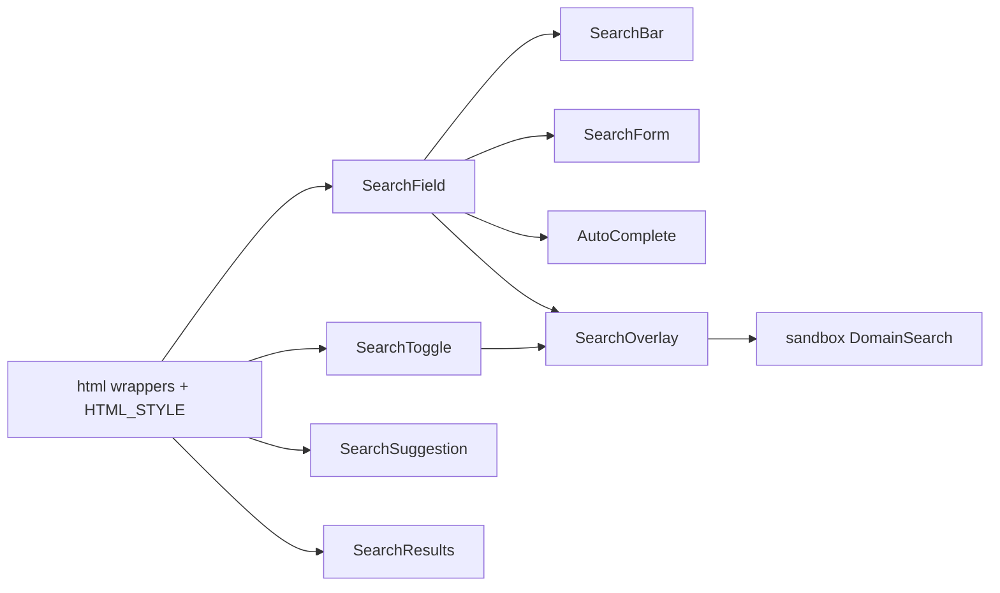

# search

`html` owns `<search>`, `<input type="search">`, `<form>`, `<button>`, `<ul>`/`<li>`
and the baseline skin. `search` owns query behaviour: icon placement, Escape,
debounce, submission, disclosure, combobox and result lists. Every component is
assembled from those html wrappers, so the skin of `<search>` and its controls
applies unchanged. This domain belongs to the interaction repository.

## Families

| Family           | Joint    | Html elements                                 | Contract beyond the native elements                               |
| ---------------- | -------- | --------------------------------------------- | ----------------------------------------------------------------- |
| SearchField      | atom     | HtmlInputSearch                               | Leading icon, `bind:value`, Escape clears then `onClear/onEscape` |
| SearchToggle     | atom     | HtmlButton                                    | `aria-expanded` disclosure, open/close labels                     |
| SearchSuggestion | atom     | HtmlUl, HtmlLi, HtmlButton, HtmlP             | Suggestion items, max count, loading/empty `role=status`          |
| SearchBar        | molecule | HtmlSearch, SearchField, HtmlButton           | Debounced `onSearch`, Enter, clear button                         |
| SearchOverlay    | molecule | HtmlSearch, SearchField, SearchToggle         | Field beside a toggle, `results` snippet popup, focus on open     |
| SearchForm       | organism | HtmlSearch, HtmlForm, SearchField, HtmlButton | Named GET submission, or `onSearch` instead of it                 |
| AutoComplete     | organism | SearchField (`role=combobox`), HtmlUl, HtmlLi | ARIA combobox: listbox, activedescendant, arrows/Enter/Escape     |
| SearchResults    | organism | HtmlUl, HtmlLi, HtmlButton, HtmlP, Icon       | Typed result rows, metadata, max count, loading/empty states      |

## Consolidation

| Removed                                      | Replacement                       | Reason                                                    |
| -------------------------------------------- | --------------------------------- | --------------------------------------------------------- |
| `search/component/atom/auto-search`          | SearchField                       | Same text field with an icon; it was `type="text"`        |
| `form/component/organism/search-form`        | `search/.../organism/search-form` | Byte-identical copy, including its recipe and icon const  |
| `domain/component/atom/domain-search-field`  | SearchField (`icon={false}`)      | Generic search input with Escape; nothing domain-specific |
| `domain/component/atom/domain-search-toggle` | SearchToggle                      | Generic disclosure button                                 |
| `SlotSearchBarEvents`, `SlotAutoSearch`      | none                              | `createEventDispatcher` leftovers and the removed family  |

`domain/component/molecule/domain-search` stays in sandbox: entity scoring,
TaxonomyBreadcrumbs results and the copy-path action are sandbox behaviour. It is
now SearchOverlay with a `results` snippet and the copy button as children.

Behaviour fixes made on the way: SearchForm used to spread its own props onto
`<form>`, rendered an unnamed, unbound input and could not submit a query;
AutoComplete spread every prop (options included) onto `<input>`, closed on a
120 ms blur timer and had no combobox ARIA; its unimplemented `debounce` prop was
removed. SearchSuggestion dropped the duplicate `onValueInput` and the unused
`headerClass`; `onValueChange` reports a pick. SearchResults shows documents with
`file-text` instead of `map-pin`.

## Skin and styles

`skin?: boolean` (default `true`, SlotSearchSkin) renders the html stylesheet
scoped to `[data-search-skin]` (SEARCH_SKIN_SCOPE) on the component root. Inner
search components get `skin={false}`, so a composition installs one sheet. Turn
it off under an existing `[data-html-skin]` host or for native styling. The
sandbox treats `search` as a skinned domain, so its stories also get the
appearance panel. SearchToggle has no switch: it inherits its host's skin.

Component rules are unlayered and inside `:where()`: they beat the layered skin,
and any consumer class beats them. They hold layout and the deliberate overrides
of the skin: icon, ghost and row buttons instead of filled ones, flush form and
lists. Every value is a design token with a fallback. Custom properties:
`--search-icon-size`, `--search-control-size`, `--search-overlay-width`.

## Checks and generation

`test/render/html-contract` covers the `<search>` landmark and skin scope, native
attributes/events, label naming, Escape, disclosure, FormData submission,
debounce, the combobox pattern, the overlay and the list states.
`test/render/stories` mounts every preset of the 8 stories.

Generated barrels are not edited by hand: `yarn stylist:index` / `yarn stylist:manifest`
must drop `AutoSearch`, `RecipeAutoSearch`, `SlotAutoSearch`, `SlotSearchBarEvents`,
form's `SearchForm`/`RecipeSearchForm`/`SEARCH_ICON_NAME`, `DomainSearchField`,
`DomainSearchToggle` and their recipes, and add SearchField, SearchToggle,
SearchOverlay, their recipes and slots, SlotSearchSkin, SlotSearchForm,
SlotSearchResults, SearchSuggestionItem and SEARCH_SKIN_SCOPE.
